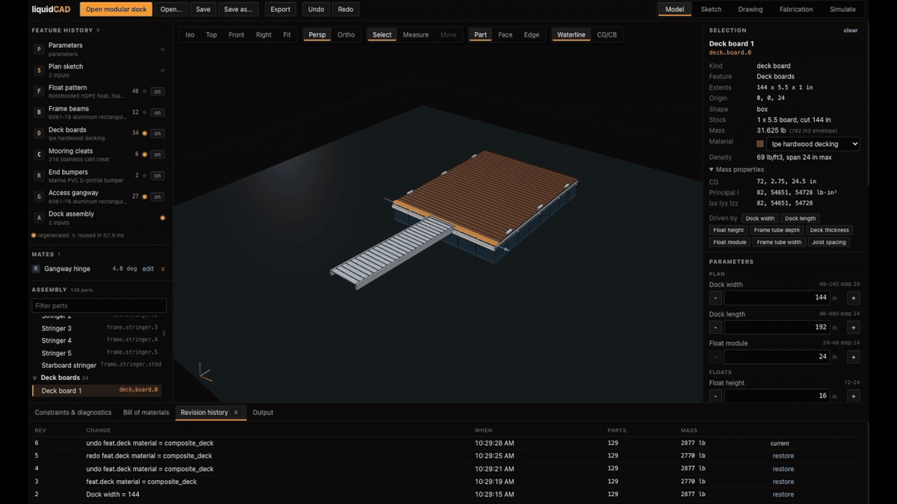

# liquidCAD

[](https://github.com/xjoepec/liquidCAD/actions/workflows/test.yml)


[](LICENSE)

Desktop CAD for designing floating docks. Runs offline.

[](docs/media/00-liquidcad.mp4)

Change a size or a material and the model updates on the spot. It tells you if the dock will sink, tip, or flex too much, and if the gangway is too steep. You can export drawings, 3D models, a PDF sheet, and a parts list.

## Run it

You need Rust and Node 20 or newer.

```bash
npm run setup
npm start
```

Then click **Open modular dock**.

On a Mac, if the build fails, run `sudo xcodebuild -license accept` and try again.

## Rounded edges and curves

Basic box shapes work out of the box, and that's enough for the sample dock. Curves, rounded edges, and cut-outs need OpenCascade:

```bash
brew install opencascade           # Mac
sudo apt install libocct-*-dev     # Ubuntu
```

Without it, those features show an error. The app doesn't fake them.

## Other commands

```bash
npm test        # run the tests
npm run desktop # run with live reload while editing code
npm run package # build a standalone app
```

## Limits

- The wave simulation is a rough check. Don't use it to certify a dock.
- One dock template.
- The app isn't code-signed, so your OS may warn you the first time you open it.

## Credit

Some ideas come from KinetiCAD by Andrew Blumson (MIT). No code was copied.

## License

MIT. See [LICENSE](LICENSE).
