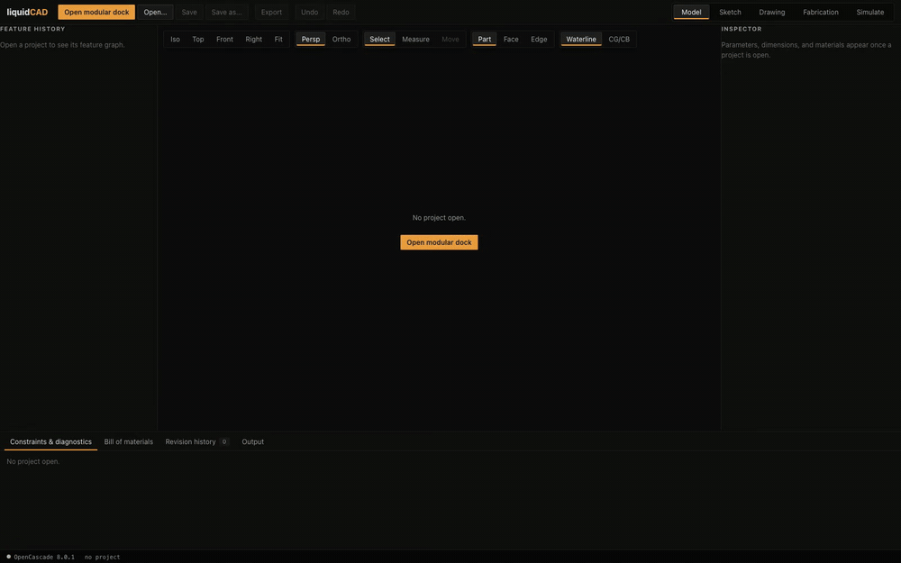
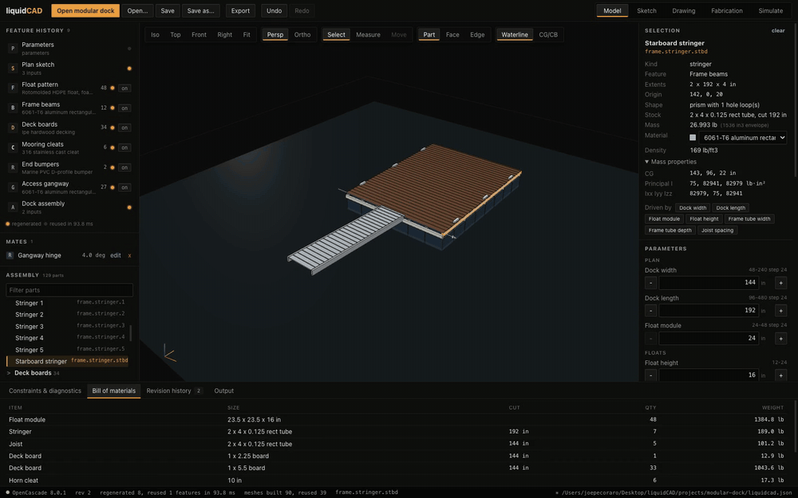
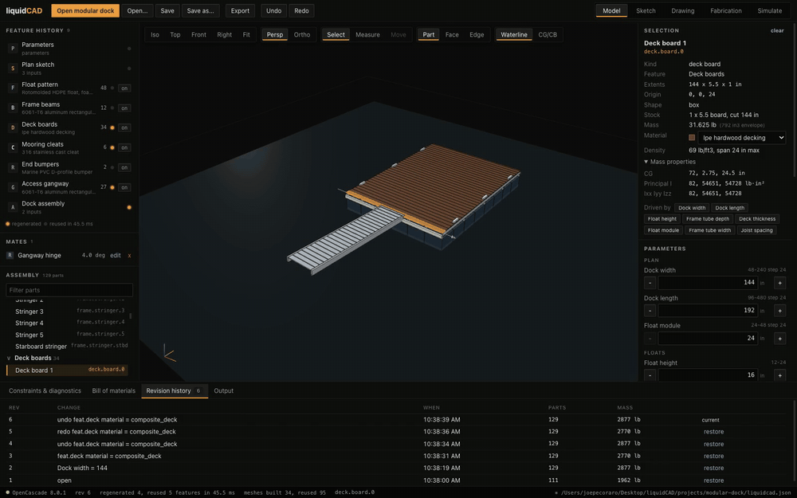
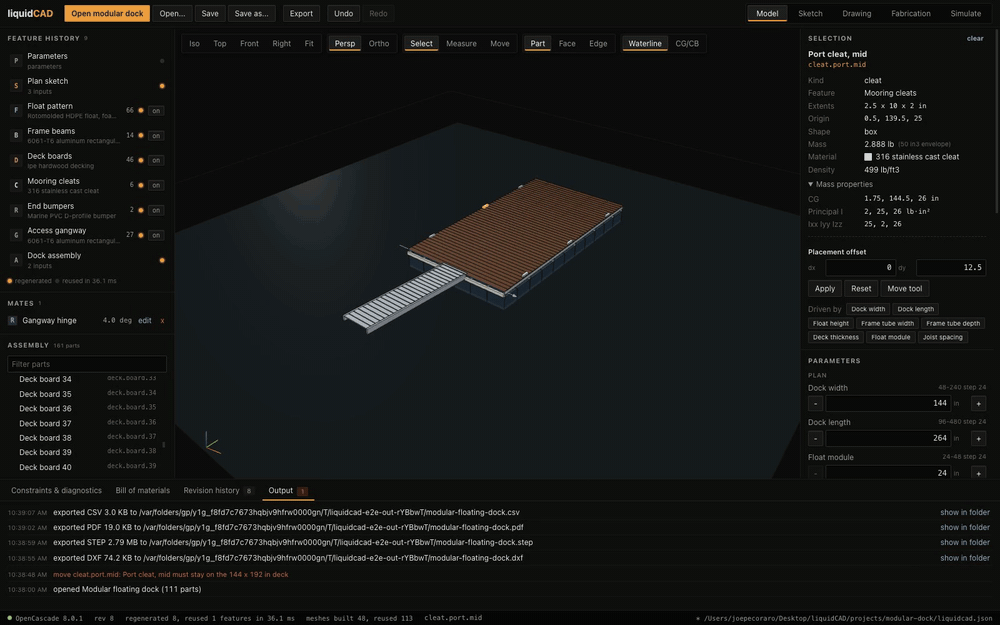
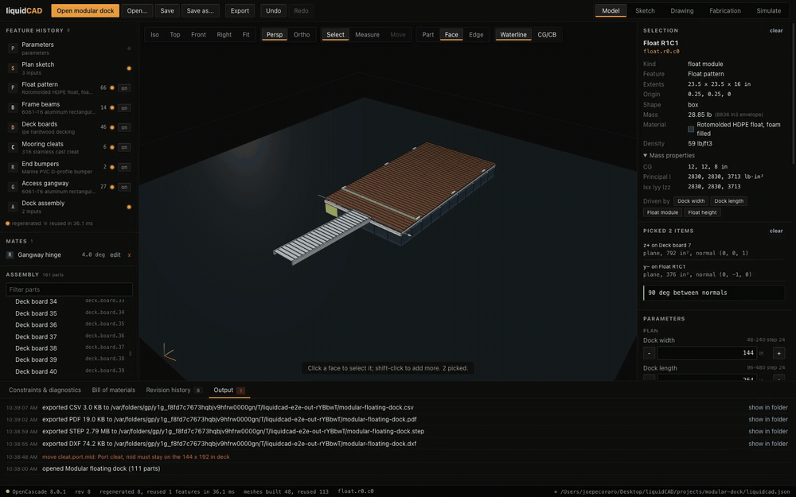
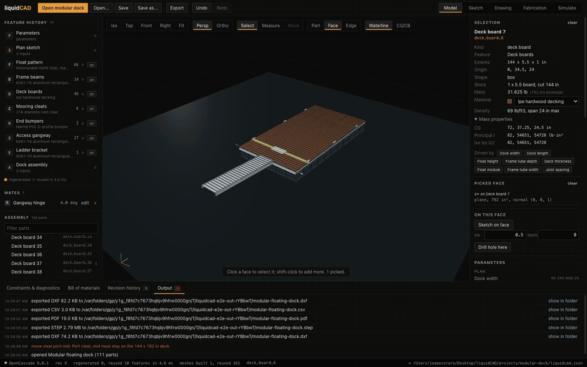
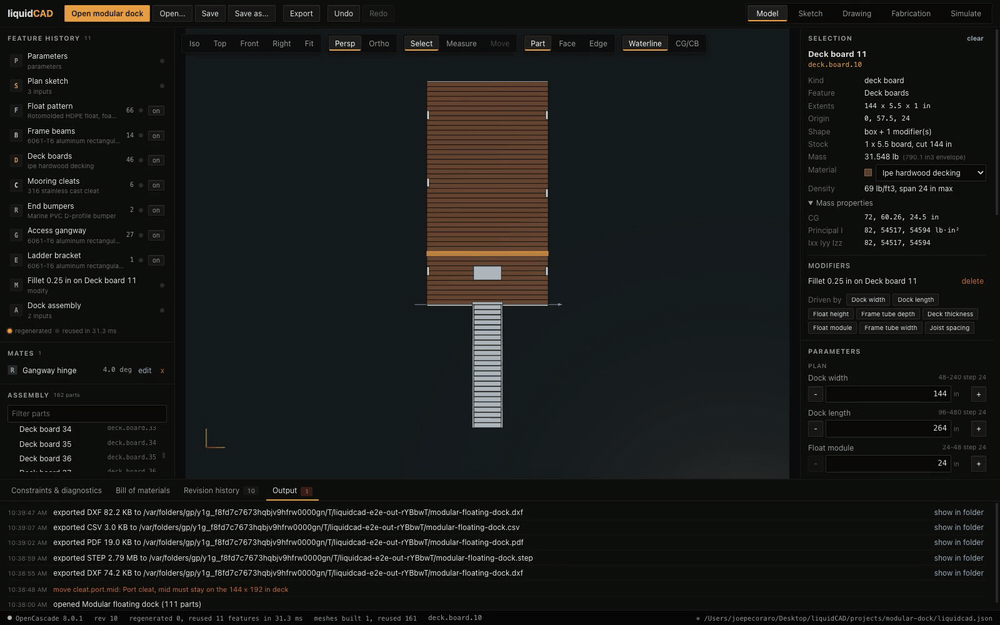
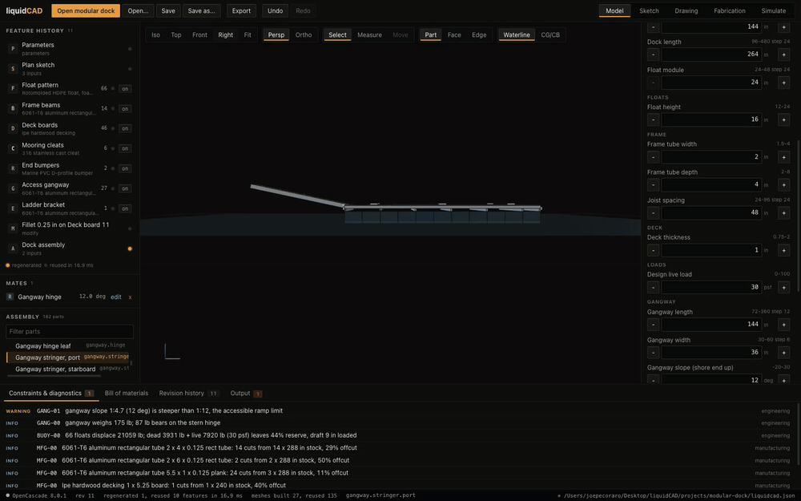
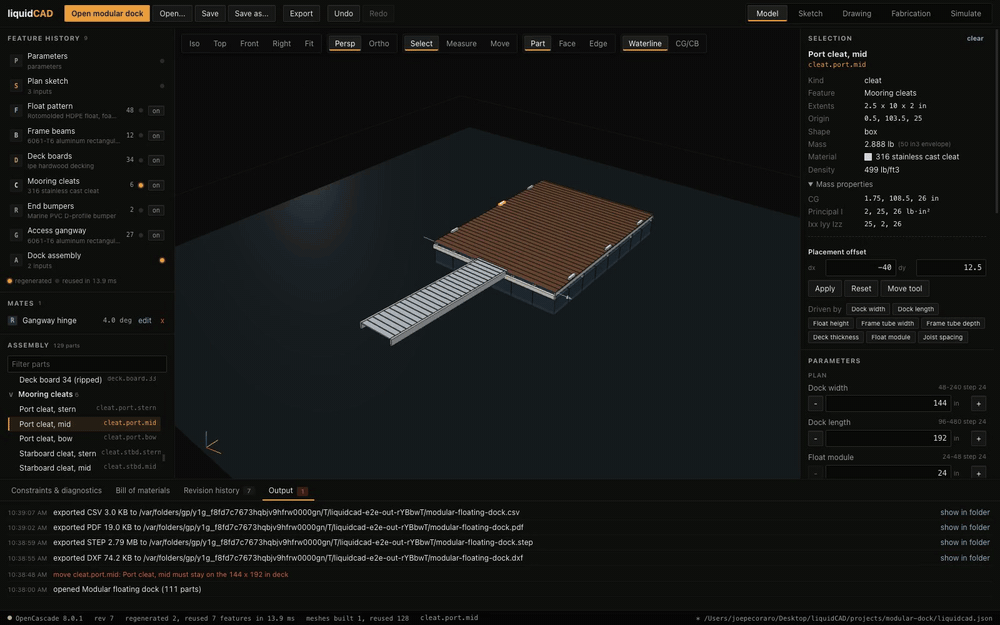

# liquidCAD

Offline desktop CAD for floating docks. The Rust engine builds the geometry, checks the engineering, and writes every export. Electron draws the result and does nothing else.

[](docs/media/00-liquidcad.mp4)

The real app, unedited. Click it for the full-resolution MP4.

Open the sample dock and change a number. Rust rebuilds the parts that read that number and leaves the rest alone. Buoyancy, stability, span, and gangway checks rerun on every edit. Exports are real DXF, STEP, PDF, and CSV files that the CLI re-reads and verifies. Nothing is mocked and no format is faked.

## Feature clips

Each clip is one Playwright test driving the real app, recorded by `npm run demo`. Click a GIF for its MP4.

**Open the dock, pick a part, widen it. The BOM updates.**
[](docs/media/01-open-and-resize.mp4)

**Swap the deck material. SPAN-01 trips. Undo clears it, redo brings it back.**
[](docs/media/02-materials-and-undo.mp4)

**Move a cleat. It snaps to the half inch and can't leave the dock edge.**
[](docs/media/03-move-a-cleat.mp4)

**Pick faces by name, measure between them, show centres of gravity and buoyancy.**
[](docs/media/04-pick-and-measure.mp4)

**Sketch a bracket on a deck board. It lands in the model, the BOM, and the DXF.**
[](docs/media/05-sketch-a-part.mp4)

**Fillet an edge through OpenCascade. The round is a true cylinder with an exact area.**
[](docs/media/06-fillet-an-edge.mp4)

**Swing the gangway on its hinge. Its 27 parts rebuild, nothing else does. Past 1:12, GANG-01 trips.**
[](docs/media/07-gangway-hinge.mp4)

**Run the dock through waves, then play it back.**
[](docs/media/08-wave-simulation.mp4)

**Drag the sketch. The drawing sheet and cut plan follow. Export all four formats.**
[](docs/media/09-drawings-and-exports.mp4)

## Run it

You need Rust 1.80+ and Node 20+. OpenCascade is optional.

```bash
npm run setup      # install the desktop app, build the engine
npm start          # launch the app
```

Click **Open modular dock**.

Builds fail on a Mac that hasn't accepted the Xcode licence. Run `sudo xcodebuild -license accept`, or `source scripts/macos-clt-env.sh` before building.

### OpenCascade

Without OpenCascade, the built-in Rust kernel builds boxes and straight prisms with holes. That is enough for the whole sample dock. Arcs, revolves, fillets, chamfers, holes, and cuts need OpenCascade. Without it they fail with `OCCT-01` and exports stay blocked until you install it. The engine never approximates a shape it can't build.

```bash
micromamba create -p .occt -c conda-forge "occt>=7.8"   # any OS, no admin
brew install opencascade                                # macOS
sudo apt install libocct-*-dev                          # Debian/Ubuntu
```

On Windows, install the official binaries, set `OCCT_ROOT`, and add its `win64\vc14\bin` to `PATH`. `build.rs` finds OCCT without configuration. The status bar shows which kernel is active.

Linux also needs Electron's runtime libraries: `sudo apt install libgtk-3-0 libnss3 libasound2 libxss1 libgbm1`.

## Commands

```bash
npm run desktop        # dev mode with hot reload
npm test               # Rust tests + Vitest
npm run test:no-occt   # Rust tests again, OpenCascade disabled
npm run test:e2e       # Playwright drives the real app; screenshots go to artifacts/screens
npm run lint           # rustfmt, clippy -D warnings, tsc
npm run demo           # re-record the feature clips into docs/media (needs ffmpeg)
npm run package        # unpacked app with the engine and OpenCascade libraries bundled
npm run milestone      # the full milestone run, headless

cargo run -p liquidcad-cli -- info                       # parameters, checks, BOM
cargo run -p liquidcad-cli -- export --out artifacts/x   # DXF, STEP, PDF, CSV
cargo run -p liquidcad-cli -- verify artifacts/x         # re-read and check every export
```

`npm run demo` regenerates the nine feature clips. It does not touch `00-liquidcad`, which is a separate screen recording.

## How it works

- **The engine owns the model.** Geometry, validation, mass, and exports all run in Rust. The UI only renders what the engine sends.
- **The UI can't touch your files.** It sends a fixed set of typed requests, each validated by zod. No request accepts a file path. Open, save, and export go through native dialogs.
- **Edits rebuild only what they affect.** Each feature declares the parameters it reads. The engine rebuilds a feature only when one of those parameters, or a feature upstream of it, changes.
- **Names don't drift.** Parts are named by role (`frame.stringer.stbd`). Faces and edges are named by how they were built (`z+`, `side.3`, `fillet(y-|z+)`). Resizing keeps every name. If a referenced face disappears, you get `FEAT-01`. The engine never retargets a reference to a different face.
- **Exports come from the exact solid model.** The display mesh is never exported. The engine validates every shape before using it.
- **Edits are atomic.** The engine rebuilds on a copy and swaps it in only on success. A failed edit leaves the model as it was. Undo history lives in SQLite.
- **OpenCascade can't corrupt the protocol.** The engine moves its protocol channel off stdout before loading OpenCascade, so OCCT console output can't break a message.

| Path | What |
| --- | --- |
| `crates/liquidcad-core` | Model, parameters, feature graph, generators, mates, mass, hydrostatics, BOM |
| `crates/liquidcad-occt` | Rust solid-model kernel, STEP writer, C++ OpenCascade adapter |
| `crates/liquidcad-sim` | Wave motion screening |
| `crates/liquidcad-dxf`, `liquidcad-mfg` | DXF, PDF, CSV, cut plans, manufacturing checks |
| `crates/liquidcad-store` | SQLite projects and revisions |
| `crates/liquidcad-engine`, `liquidcad-protocol`, `liquidcad-cli` | Session, protocol types, `liquidcad` binary |
| `apps/desktop` | Electron, React, Three.js, Vitest, Playwright |
| `projects/modular-dock` | The sample dock |
| `docs/media` | README video and feature clips |

## Engineering checks

Displacement is float volume × 62.4 lb/ft³, the density of fresh water. Stability uses GM = KB + BM − KG, computed across and along the dock. The crowd case puts half the live load on one side.

| Code | Trips when |
| --- | --- |
| BUOY-01 / BUOY-03 | Overloaded / draft above 80% of float height |
| FREE-01 | Freeboard under 10 in |
| SPAN-01 / SLEND-01 | Deck span over rating / stringer span-to-depth over 20 |
| STAB-01 / 02 / 03 | GM ≤ 0 / crowd heel over 5° / static heel or trim over 2° |
| GANG-01 | Gangway steeper than 1:12 |
| SIM-01 / 02 / 03 | Deck floods / a float lifts clear / deck acceleration over 0.2 g |
| MFG-01, PLACE-01, MATE-01..03, OCCT-01, FEAT-01 | Splice needed, placement clamped, mate broken, feature failed |

The simulation screens for problems. It is not a seakeeping analysis. It models heave, roll, and pitch in regular waves with linear damping. It ignores surge, sway, yaw, radiation, and diffraction. Don't certify a dock with it.

## Limits

- Without OpenCascade, the Rust kernel can't build curved or modified parts. It reports them as failures instead of faking them.
- Mates form a simple tree. There is no constraint solver. Hinge and slider are the only joint types.
- The DXF plan view draws curves on tilted parts as sampled points. Flat cut profiles are exact.
- Cleats and bumpers use simplified mass, so removing material from them gives an approximate mass.
- One dock template. One drawing page.
- Installers aren't signed. Signing needs your certificates.

## Credit

Topology picking, mass properties, sketch-to-extrude, mates, and simulation follow ideas from KinetiCAD by Andrew Blumson (MIT). liquidCAD reimplements them from scratch in Rust and uses none of its code.
